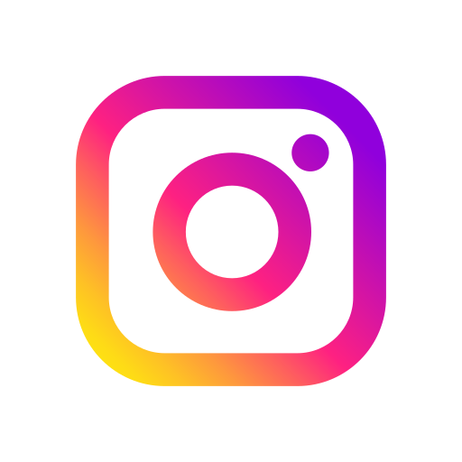
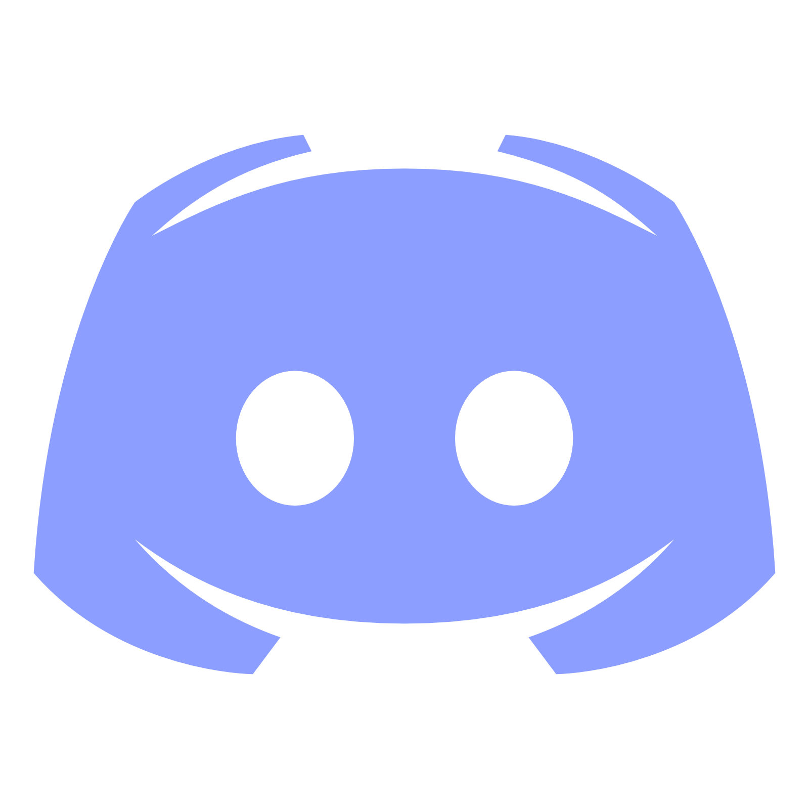

 

---

## 👨‍💻 About Me

- 🎓 Studying Physical Science with Mathematics, Statistics, and Computer Science.
- 🌱 Currently developing my programming and web development skills.
- 💻 Interested in creating modern, responsive, and user-friendly websites.
- 🧠 I enjoy solving problems and learning how software works.
- 🎯 My goal is to become a Full-Stack Engineer and build real-world applications.
- 🤝 Open to learning opportunities, collaboration, and future software engineering internships.

---

## Connect with me

&nbsp;

&nbsp; &nbsp; &nbsp; &nbsp;

&nbsp; &nbsp; &nbsp; &nbsp;

&nbsp; &nbsp; &nbsp; &nbsp;

&nbsp; &nbsp; &nbsp; &nbsp;

	

  

---

## 🛠️ My Tech Stack

### 💻 Programming Languages

### ⚙️ Development Tools

### 🌐 Technologies on My Learning Roadmap

I'm learning the fundamentals first and will add these technologies to my active skill set as I gain experience.

---

## 🎯 My Developer Roadmap

- [x] Create a GitHub profile and start using Git
- [x] Begin learning C programming
- [x] Set up a development environment using VS Code
- [ ] Strengthen programming fundamentals and problem-solving
- [ ] Master HTML and CSS
- [ ] Build interactive applications with JavaScript
- [ ] Learn responsive web design
- [ ] Learn React for front-end development
- [ ] Learn Node.js and Express for back-end development
- [ ] Learn SQL and database design
- [ ] Build and deploy full-stack applications
- [ ] Develop a strong portfolio for software engineering internships

---
## 🐍 My Contribution Journey

---

## ☕ A Little Motivation

> "Great software is built one problem, one solution, and one line of code at a time."

**Learn something new. Build something useful. Repeat.** 💙

 

